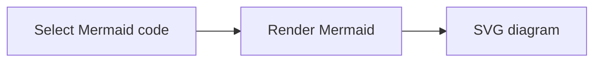

# Render Mermaid

Turn selected Mermaid code into an SVG or PNG diagram using [Pele](https://pele.run/). Rendering happens entirely on your Mac, with no account, API key, or network connection required.

Select raw Mermaid code or a complete fenced `mermaid` block, open OpenClip, and choose **Render Mermaid**. The result card lets you preview, copy, save, or open the diagram. Right-click or Shift-click the action to copy the diagram file immediately.

In the action's settings, choose:

| Option | Choices | Default |
| --- | --- | --- |
| Format | SVG (vector), PNG (image) | SVG |
| Theme | Light, dark | Light |
| Transparent background | On, off | Off |
| Font size | 12, 16, 20, 24 pixels | 16 |
| Padding | 8, 16, 24, 32 pixels | 8 |
| PNG scale multiplier | 1×, 2×, 3× | 2× |

PNG scale affects image resolution; SVG remains a vector at any zoom. PNG export supports up to 8,192 pixels on either edge and 16 megapixels total. For larger diagrams, reduce the PNG scale or choose SVG.

Try selecting this code:

Supports Pele's built-in diagram types, including flowcharts, sequences, class diagrams, state diagrams, Gantt charts, and pie charts. Exports use fixed colors for use in other apps. Colors set explicitly in Mermaid code override the theme. External images and clickable links are disabled. Invalid code shows an error instead of producing a file.

Requires **OpenClip 1.7.0 or later**. Pele is bundled; PNG conversion uses macOS's built-in image APIs. Node.js and additional tools are not needed to use this extension. The defaults work without configuration.

Powered by [Pele](https://github.com/obsidianmd/pele), distributed under the MIT license. Third-party license notices are included in the package.

The icon is a monochrome adaptation of the [Mermaid logo](https://mermaid.js.org/favicon.svg), with its MIT license included in the package.
